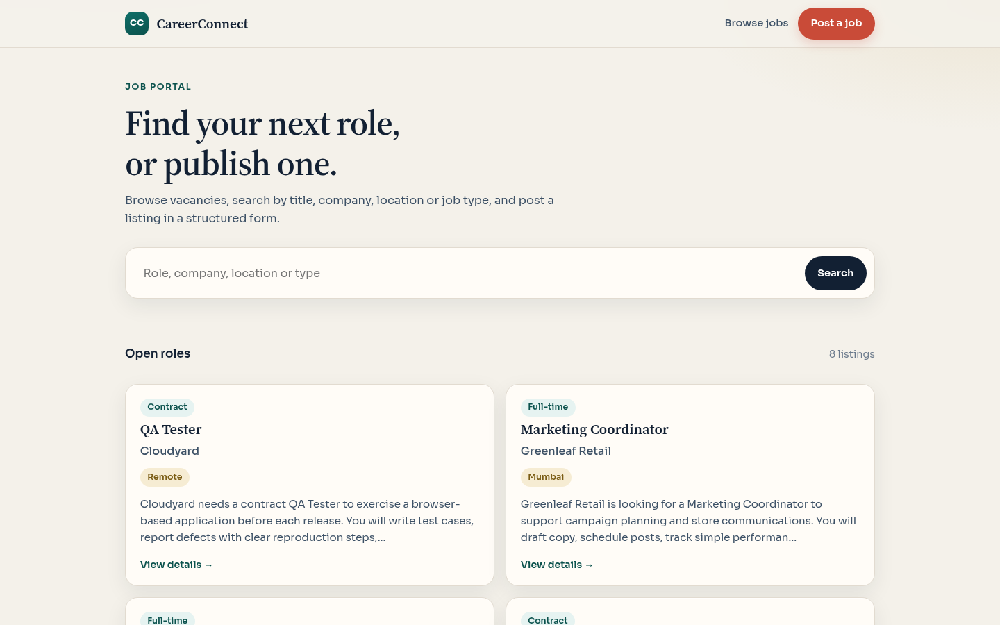
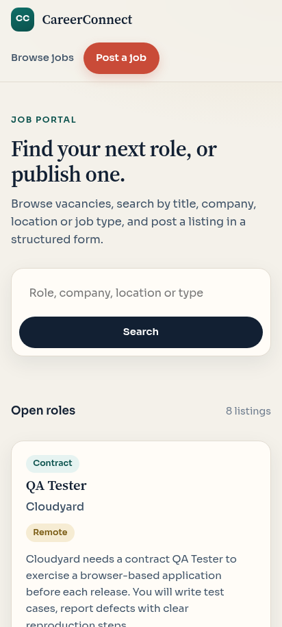
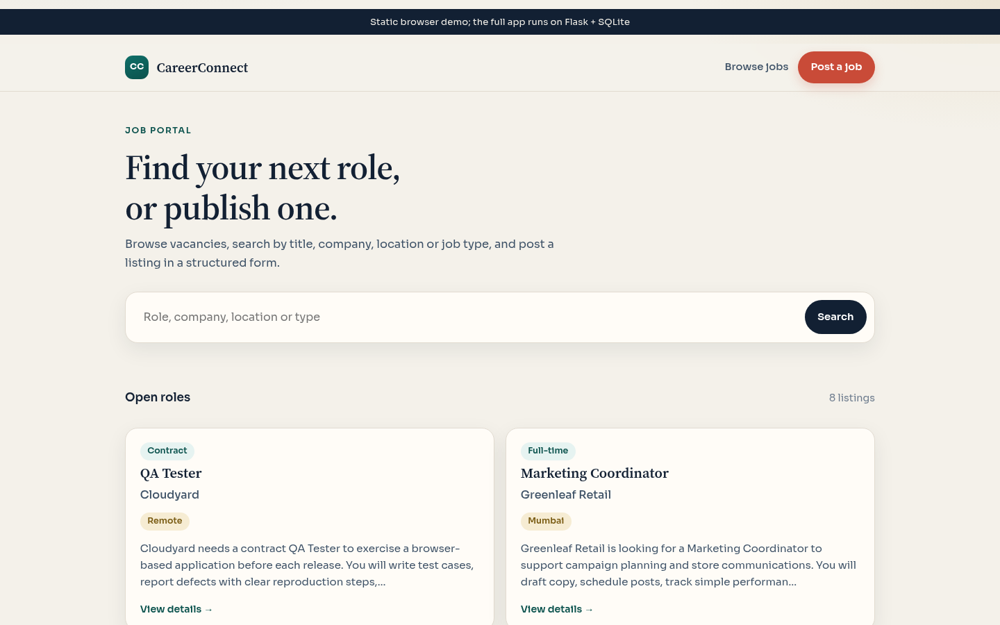

# CareerConnect

A compact job portal for browsing vacancies, searching by keyword, reading a full listing, and publishing a new role. CareerConnect is an academic prototype built with Python, Flask, Jinja, HTML/CSS, and SQLite.

Built by **Prafull Joshi**.

## Live demo

- Static browser demo: https://prafullj0shi.github.io/CareerConnect/
- Hosted Flask app (Render): _add the Render URL after the first deploy_

The GitHub Pages site is a client-side replica of the same pages. It uses the same design and sample jobs, and it stores new listings in the browser. The full application runs on Flask with SQLite.

## Screenshots

### Home page (desktop)



### Home page (mobile)



### Static demo



## Features

- Home page of available job listings
- Keyword search across job title, company, location, and job type
- A clear no-results message when nothing matches
- Job detail page with the full description and a `mailto` contact link
- A not-found page for an unknown job ID
- Job posting form with server-side checks for empty fields and a basic email format
- Confirmation flash message after a successful post
- SQLite storage, created automatically, with eight sample listings that use reserved `.example` email addresses

## Architecture

The application follows a simple three-part structure:

1. **Presentation** — HTML templates, CSS, and the browser
2. **Application** — Flask routes, form validation, and template rendering
3. **Data** — an SQLite `jobs` table

```
Browser  →  Flask (app.py)  →  db.py  →  SQLite
                ↓
         Jinja templates + static/css
```

The `jobs` table stores `id`, `title`, `company`, `location`, `job_type`, `description`, and `email`. Database access uses parameterized SQL.

## How to run

Python 3.10 or newer is required.

```bash
pip install -r requirements.txt
python app.py
```

Then open http://127.0.0.1:5000/

To run with gunicorn:

```bash
gunicorn --bind 0.0.0.0:5000 'app:create_app()'
```

Optional environment variables:

- `SECRET_KEY` — Flask secret for flash messages (a development fallback is used if this is unset)
- `DATABASE` — path to the SQLite file

A GitHub Codespaces / VS Code dev container is included in `.devcontainer/`. For a hosted deploy, `render.yaml` and a `Procfile` start the app with `gunicorn 'app:create_app()'`.

## Tests

The test suite covers the seven cases from the project synopsis: the home page, keyword search, a no-match search, job details, an invalid job ID, a successful post, and an empty form.

```bash
pytest -q
```

## Project limitations

- The current version does not include a user login or registration system.
- Job listings are not independently verified, and the posting form is open in the prototype.
- The portal does not store résumés or process applications internally.
- The contact action relies on the visitor's email application.
- The database is designed for a small local demonstration and is not configured for large-scale deployment.

## Future scope

- Separate accounts and dashboards for job seekers and employers
- Candidate profiles and secure résumé uploads
- Direct applications through the portal
- Application status tracking and email notifications
- Employer verification and administrator moderation
- Filters for experience, salary range, skills, and employment category
- Deployment with a production server and a managed database

## License

[MIT](LICENSE) © 2026 Prafull Joshi
